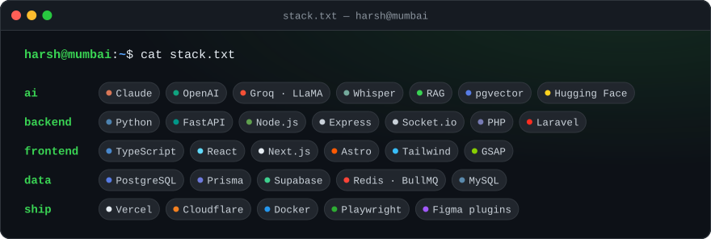

<div align="center">



<a href="https://www.linkedin.com/in/harsh-parmar-84820b222"></a>&nbsp;&nbsp;
<a href="mailto:harshcparmar2002@gmail.com"></a>

</div>

<br />

### `~/about`

```yaml
name: Harsh Parmar
role: AI & Full-Stack Developer
based_in: Mumbai, India
i_build:
  - RAG assistants grounded in your own documents, not generic answers
  - AI agents and automation (bots, lead intake, internal tools)
  - full products end to end (FastAPI / Node, Next.js, Postgres)
right_now:
  - Clipmaker → long videos into ready-to-post vertical clips
  - Figma to Code → designs into pixel-checked HTML/CSS
  - AI agents for clinics, real estate and staffing businesses
recent_win: ClaimSathi, built at the Claude Build Day in Mumbai
open_to: [freelance projects, full-time roles]
rule: start from the real bottleneck. If AI isn't the right tool, I'll say so.
```

### `~/projects`

<p align="center">
  <a href="https://github.com/HarshParmar321/Claude-Build"></a>
  <a href="https://github.com/HarshParmar321/Clipmaker"></a>
  <a href="https://github.com/HarshParmar321/FlowDesk"></a>
  <a href="https://github.com/HarshParmar321/figma-to-code"></a>
  <a href="https://github.com/HarshParmar321/chatbot-pdf"></a>
  <a href="https://github.com/HarshParmar321/ShipMargin"></a>
</p>

<p align="center">
  <sub>try them live&nbsp; → &nbsp;<a href="https://chatbot-pdf-mu.vercel.app">pdf buddy</a> · <a href="https://shippingmath.com">shippingmath.com</a> · <a href="https://resume-maker-bay-alpha.vercel.app">resume maker</a></sub>
</p>

<details>
<summary><b><code>$ ls ~/projects --all</code></b> &nbsp;more things I've built</summary>
<br />

| project | what it does | stack |
| --- | --- | --- |
| [Sodio Triage](https://github.com/HarshParmar321/Vibe-Coder-Task) | Turns messy enquiry messages into a reviewable, editable project pipeline | FastAPI · SQLAlchemy · React · OpenAI |
| [Mini Agent](https://github.com/HarshParmar321/mini-agent) | Plain-English order agent with planning, async tools and guardrails, no LangChain, plus a live pipeline visualizer | Python · FastAPI |
| [Ads Dashboard](https://github.com/HarshParmar321/ads-dashboard) | One analytics view across Google, Meta, LinkedIn, TikTok, X and more, synced in the background | Next.js · BullMQ · Redis |
| [Resume Maker](https://github.com/HarshParmar321/resume_maker) · [live](https://resume-maker-bay-alpha.vercel.app) | ATS-friendly resume builder with templates, live preview and PDF export | Next.js · React · Tailwind |
| [WorkTrack](https://github.com/HarshParmar321/worktrack) | Employee hours tracker with projects, reports and a dashboard | Node · Express · PostgreSQL |
| [Binder landing](https://github.com/HarshParmar321/Binder_Landing) | Cinematic, interactive landing page with GSAP animation | Next.js · GSAP |
| [Aerpace](https://github.com/HarshParmar321/Task_Website_For_Aerpace) · [live](https://task-website-for-aerpace.vercel.app) | Animated landing page for an urban air mobility startup | Next.js · Tailwind |
| [Content Whale](https://github.com/HarshParmar321/Content_whale) · [live](https://content-whale-eta.vercel.app) | Content-services site with a custom pricing calculator | Next.js · TypeScript |
| [SUVIT blog](https://github.com/HarshParmar321/suvit_blog) · [live](https://blog-task-neon.vercel.app/blog) | Blog with tag filters, pagination and featured posts | Next.js · TypeScript |

</details>

### `~/stack`



### `~/stats`



<picture>
  <source media="(prefers-color-scheme: dark)" srcset="https://github.com/HarshParmar321/HarshParmar321/raw/main/assets/snake-dark.svg" />
  <source media="(prefers-color-scheme: light)" srcset="https://github.com/HarshParmar321/HarshParmar321/raw/main/assets/snake-light.svg" />
  
</picture>

<div align="center">
  <sub><code>$ exit</code> &nbsp;·&nbsp; got a problem worth solving? <a href="mailto:harshcparmar2002@gmail.com?subject=Project%20enquiry">tell me about it</a>, I usually reply within a day</sub>
</div>
